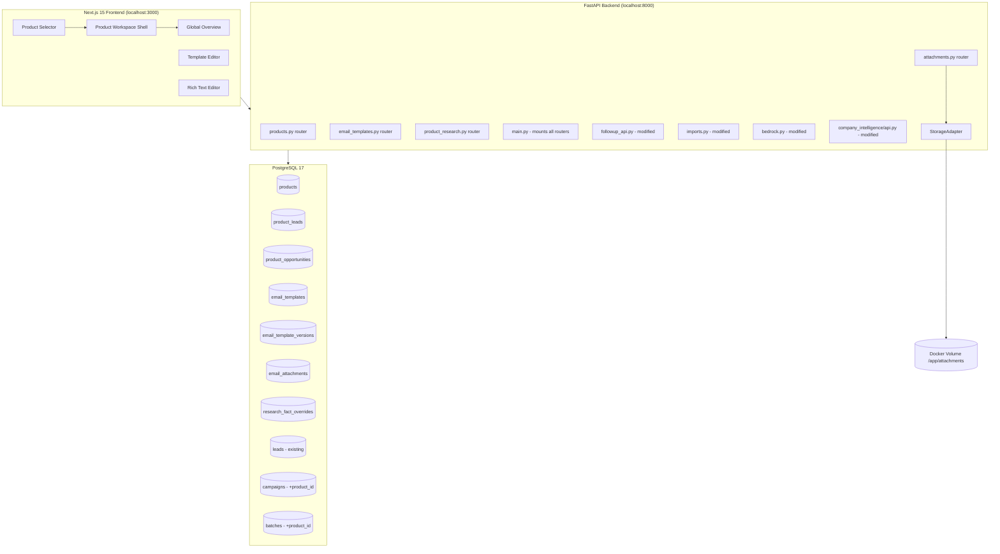

# Design Document: Multi-Product Sales Platform

## Overview

This document describes the technical design for converting the DENSO GTMProspecting platform from a single-context sales tool into a multi-product workspace. The platform currently stores all leads, campaigns, research, and messages in a flat, product-agnostic schema. This design layers product-scoped associations, templates, opportunity analysis, and navigation on top of that schema without altering existing tables.

The approach is strictly additive: two new migrations create new tables and nullable FK columns; existing rows are attributed to General/Unassigned by a data migration. All 113 existing backend tests must continue to pass throughout.

---

## Architecture



**Request flow for product-scoped operations:**
1. Frontend sends request with `productSlug` from URL.
2. Backend resolves `productSlug → product_id` on each request.
3. All queries filter or validate against the resolved `product_id`.
4. Cross-product access returns 403 or 422 immediately without touching unrelated rows.

---

## Components and Interfaces

### Backend Components

#### `backend/app/products.py` (new)
Handles product CRUD, product-lead CRUD, product-lead import delegation, and product overview aggregation.

```python
# Key endpoint signatures
GET  /products                       -> list[ProductResponse]
POST /products                       -> ProductResponse
GET  /products/{product_id}          -> ProductResponse
PUT  /products/{product_id}          -> ProductResponse
PATCH /products/{product_id}/status  -> ProductResponse

GET  /products/{product_id}/leads              -> list[ProductLeadResponse]
POST /products/{product_id}/leads              -> ProductLeadResponse
PUT  /products/{product_id}/leads/{lead_id}    -> ProductLeadResponse
DELETE /products/{product_id}/leads/{lead_id}  -> 204

POST /products/{product_id}/batches  -> BatchImportResponse  # delegates to imports.py

GET  /products/{product_id}/overview -> ProductOverviewResponse
GET  /overview                       -> GlobalOverviewResponse
```

#### `backend/app/email_templates.py` (new)
Template CRUD with versioning and preview.

```python
GET   /templates                     -> list[TemplateResponse]
POST  /templates                     -> TemplateResponse
GET   /templates/{template_id}       -> TemplateResponse
PUT   /templates/{template_id}       -> TemplateResponse
PATCH /templates/{template_id}/status -> TemplateResponse
POST  /templates/{template_id}/preview -> TemplatePreviewResponse
GET   /templates/{template_id}/versions -> list[TemplateVersionResponse]
```

#### `backend/app/attachments.py` (new)
File upload, download, and deletion with StorageAdapter injection.

```python
POST   /messages/{message_id}/attachments              -> AttachmentResponse
GET    /messages/{message_id}/attachments/{att_id}     -> FileResponse
DELETE /messages/{message_id}/attachments/{att_id}     -> 204
```

#### `backend/app/product_research.py` (new)
Opportunity analysis generation and research diff.

```python
POST /products/{product_id}/leads/{lead_id}/opportunity  -> OpportunityResponse
GET  /products/{product_id}/leads/{lead_id}/opportunity  -> OpportunityResponse
PATCH /products/{product_id}/leads/{lead_id}/opportunity/{opp_id}/status -> OpportunityResponse

GET  /research/jobs/{job_id}/diff                        -> ResearchDiffResponse
POST /research/facts/{fact_id}/override                  -> FactOverrideResponse
```

#### `backend/app/storage.py` (new)
Abstract storage interface and local implementation.

```python
class SourceResult:
    content: bytes
    content_type: str
    url: str

class StorageAdapter(ABC):
    @abstractmethod
    def store(self, key: str, data: bytes) -> str: ...
    @abstractmethod
    def retrieve(self, key: str) -> bytes: ...
    @abstractmethod
    def delete(self, key: str) -> None: ...

class LocalStorageAdapter(StorageAdapter):
    base_path: Path = Path("/app/attachments")
    # Writes to base_path / key with atomic rename
```

#### `backend/app/company_intelligence/sources/base.py` (new)
Abstract SourceProvider interface that existing HTTP, PDF, and browser implementations adopt.

```python
class SourceProvider(ABC):
    @abstractmethod
    def fetch(self, url: str) -> SourceResult: ...
```

### Modified Backend Files

| File | Change |
|---|---|
| `main.py` | Mount new routers; add PATCH, DELETE to CORS allowed methods |
| `imports.py` | Accept optional `product_id`; create ProductLead after batch import |
| `followup_api.py` | Campaign creation accepts `product_id`; enrollment validates ProductLead membership |
| `bedrock.py` | Accept `ProductGenerationContext` dataclass; resolve product + template + opportunity context |
| `company_intelligence/api.py` | Add `/diff` and `/opportunity` endpoints; add override endpoint |

### Frontend Components

#### `frontend/lib/products.ts` (new)
API client and shared types. Exports `useProducts()` hook backed by React context.

```typescript
interface Product {
  id: string;
  name: string;
  slug: string;
  status: 'active' | 'archived';
  short_description: string;
  primary_color: string;
  logo_url: string | null;
}

interface ProductLead {
  id: string;
  product_id: string;
  lead_id: string;
  stage: Stage;
  priority: Priority;
  status: 'active' | 'inactive';
  sales_notes: string | null;
}

function useProducts(): { products: Product[]; loading: boolean; error: string | null }
```

#### `frontend/components/product-selector.tsx` (new)
Top-bar dropdown populated from `useProducts()`. Renders active products only plus "Add product" link.

#### `frontend/components/product-workspace.tsx` (new)
Workspace shell: renders sub-nav (Overview, Companies, Import, Research, Contacts, Lead 360, Campaigns, Templates, Meetings, Analytics) and breadcrumbs. Accepts `productSlug` prop.

#### New pages under `frontend/app/products/[slug]/`
- `page.tsx` → Overview
- `companies/page.tsx` → Companies list
- `import/page.tsx` → Product-scoped import
- `research/page.tsx` → Research list
- `contacts/page.tsx` → Contacts
- `lead360/[leadId]/page.tsx` → Lead 360 view
- `campaigns/page.tsx` → Campaigns
- `templates/page.tsx` → Templates
- `meetings/page.tsx` → Meetings
- `analytics/page.tsx` → Analytics

#### Modified Frontend Files

| File | Change |
|---|---|
| `app-shell.tsx` | Add `<ProductSelector>` to top bar; keep existing sidebar for global nav |
| `app/page.tsx` | Add global overview section and product workspace entry points |
| `style.css` | Add: product-selector, breadcrumbs, workspace sub-nav, template editor, attachment upload, rich-text editor styles |

---

## Data Models

### New Tables (Migration 0011)

#### `products`
```sql
CREATE TABLE products (
    id          UUID PRIMARY KEY DEFAULT gen_random_uuid(),
    name        VARCHAR(200) NOT NULL,
    slug        VARCHAR(100) NOT NULL UNIQUE,
    description TEXT,
    short_description VARCHAR(400),
    logo_url    VARCHAR(500),
    primary_color VARCHAR(20),
    status      VARCHAR(20) NOT NULL DEFAULT 'active',  -- 'active' | 'archived'
    product_context TEXT,
    value_proposition TEXT,
    target_industries JSONB DEFAULT '[]',
    created_at  TIMESTAMP WITH TIME ZONE DEFAULT now(),
    updated_at  TIMESTAMP WITH TIME ZONE DEFAULT now(),
    CONSTRAINT products_slug_format CHECK (slug ~ '^[a-z0-9][a-z0-9\-]*[a-z0-9]$'),
    CONSTRAINT products_status_check CHECK (status IN ('active', 'archived'))
);
```

#### `product_leads`
```sql
CREATE TABLE product_leads (
    id              UUID PRIMARY KEY DEFAULT gen_random_uuid(),
    product_id      UUID NOT NULL REFERENCES products(id),
    lead_id         INTEGER NOT NULL REFERENCES leads(id),
    stage           VARCHAR(30) NOT NULL DEFAULT 'prospect',
    priority        VARCHAR(10) NOT NULL DEFAULT 'medium',
    status          VARCHAR(10) NOT NULL DEFAULT 'active',
    owner_id        INTEGER REFERENCES users(id),  -- nullable
    sales_notes     TEXT,
    associated_at   TIMESTAMP WITH TIME ZONE DEFAULT now(),
    updated_at      TIMESTAMP WITH TIME ZONE DEFAULT now(),
    UNIQUE (product_id, lead_id),
    CONSTRAINT pl_stage_check CHECK (stage IN ('prospect','qualified','engaged','proposal','closed_won','closed_lost')),
    CONSTRAINT pl_priority_check CHECK (priority IN ('high','medium','low')),
    CONSTRAINT pl_status_check CHECK (status IN ('active','inactive'))
);
```

#### `product_opportunities`
```sql
CREATE TABLE product_opportunities (
    id                  UUID PRIMARY KEY DEFAULT gen_random_uuid(),
    product_lead_id     UUID NOT NULL REFERENCES product_leads(id),
    research_job_id     INTEGER REFERENCES research_jobs(id),
    opportunity_summary TEXT,
    pain_points         JSONB DEFAULT '[]',
    use_cases           JSONB DEFAULT '[]',
    relevance_score     FLOAT CHECK (relevance_score >= 0.0 AND relevance_score <= 1.0),
    confidence          FLOAT CHECK (confidence >= 0.0 AND confidence <= 1.0),
    evidence_fact_ids   JSONB DEFAULT '[]',
    status              VARCHAR(20) NOT NULL DEFAULT 'draft',
    manual_override     BOOLEAN NOT NULL DEFAULT FALSE,
    created_at          TIMESTAMP WITH TIME ZONE DEFAULT now(),
    updated_at          TIMESTAMP WITH TIME ZONE DEFAULT now(),
    CONSTRAINT po_status_check CHECK (status IN ('draft','reviewed','approved'))
);
```

#### `email_templates`
```sql
CREATE TABLE email_templates (
    id                  UUID PRIMARY KEY DEFAULT gen_random_uuid(),
    product_id          UUID REFERENCES products(id),  -- null = global
    parent_template_id  UUID REFERENCES email_templates(id),
    name                VARCHAR(200) NOT NULL,
    type                VARCHAR(30) NOT NULL,
    subject_template    TEXT NOT NULL,
    body_template       TEXT NOT NULL,
    variables           JSONB DEFAULT '[]',
    is_active           BOOLEAN NOT NULL DEFAULT TRUE,
    version             INTEGER NOT NULL DEFAULT 1,
    created_at          TIMESTAMP WITH TIME ZONE DEFAULT now(),
    updated_at          TIMESTAMP WITH TIME ZONE DEFAULT now(),
    CONSTRAINT et_type_check CHECK (type IN ('initial','followup','product_intro','meeting_request','post_meeting','custom'))
);
```

#### `email_template_versions`
```sql
CREATE TABLE email_template_versions (
    id                  UUID PRIMARY KEY DEFAULT gen_random_uuid(),
    template_id         UUID NOT NULL REFERENCES email_templates(id),
    version             INTEGER NOT NULL,
    subject_template    TEXT NOT NULL,
    body_template       TEXT NOT NULL,
    variables           JSONB DEFAULT '[]',
    created_at          TIMESTAMP WITH TIME ZONE DEFAULT now(),
    UNIQUE (template_id, version)
);
```

#### `email_attachments`
```sql
CREATE TABLE email_attachments (
    id                  UUID PRIMARY KEY DEFAULT gen_random_uuid(),
    message_id          INTEGER REFERENCES email_messages(id),  -- nullable during upload
    upload_session_id   VARCHAR(64) NOT NULL,
    filename_safe       VARCHAR(255) NOT NULL,
    content_type        VARCHAR(100) NOT NULL,
    size_bytes          INTEGER NOT NULL,
    storage_key         VARCHAR(500) NOT NULL UNIQUE,
    upload_status       VARCHAR(20) NOT NULL DEFAULT 'pending',
    created_at          TIMESTAMP WITH TIME ZONE DEFAULT now(),
    CONSTRAINT ea_status_check CHECK (upload_status IN ('pending','complete','failed'))
);
```

#### `research_fact_overrides`
```sql
CREATE TABLE research_fact_overrides (
    id               UUID PRIMARY KEY DEFAULT gen_random_uuid(),
    fact_id          INTEGER NOT NULL REFERENCES research_facts(id),
    product_id       UUID REFERENCES products(id),  -- null = applies to all products
    override_value   TEXT NOT NULL,
    reason           TEXT,
    created_by_note  VARCHAR(500),
    created_at       TIMESTAMP WITH TIME ZONE DEFAULT now()
    -- No updated_at: append-only, no updates permitted
);
```

### Additive Columns on Existing Tables (Migration 0011)

```sql
ALTER TABLE campaigns ADD COLUMN product_id UUID REFERENCES products(id);
ALTER TABLE batches   ADD COLUMN product_id UUID REFERENCES products(id);
```

### SQLAlchemy Models (Python)

All new models go in `backend/app/models.py` alongside existing models.

```python
class Product(Base):
    __tablename__ = "products"
    id: Mapped[uuid.UUID] = mapped_column(primary_key=True, default=uuid.uuid4)
    name: Mapped[str]
    slug: Mapped[str] = mapped_column(unique=True)
    description: Mapped[str | None]
    short_description: Mapped[str | None]
    logo_url: Mapped[str | None]
    primary_color: Mapped[str | None]
    status: Mapped[str] = mapped_column(default="active")
    product_context: Mapped[str | None]
    value_proposition: Mapped[str | None]
    target_industries: Mapped[dict] = mapped_column(JSON, default=list)
    created_at: Mapped[datetime]
    updated_at: Mapped[datetime]

class ProductLead(Base):
    __tablename__ = "product_leads"
    id: Mapped[uuid.UUID] = mapped_column(primary_key=True, default=uuid.uuid4)
    product_id: Mapped[uuid.UUID] = mapped_column(ForeignKey("products.id"))
    lead_id: Mapped[int] = mapped_column(ForeignKey("leads.id"))
    stage: Mapped[str] = mapped_column(default="prospect")
    priority: Mapped[str] = mapped_column(default="medium")
    status: Mapped[str] = mapped_column(default="active")
    owner_id: Mapped[int | None]
    sales_notes: Mapped[str | None]
    associated_at: Mapped[datetime]
    updated_at: Mapped[datetime]
    __table_args__ = (UniqueConstraint("product_id", "lead_id"),)

class ProductOpportunity(Base):
    __tablename__ = "product_opportunities"
    # ... (fields as DDL above)

class EmailTemplate(Base):
    __tablename__ = "email_templates"
    # ... (fields as DDL above)

class EmailTemplateVersion(Base):
    __tablename__ = "email_template_versions"
    # ... (fields as DDL above)

class EmailAttachment(Base):
    __tablename__ = "email_attachments"
    # ... (fields as DDL above)

class ResearchFactOverride(Base):
    __tablename__ = "research_fact_overrides"
    # ... (fields as DDL above)
```

### Template Variable Allowlist (Shared Constant)

```python
# backend/app/email_templates.py
ALLOWED_TEMPLATE_VARIABLES: frozenset[str] = frozenset({
    "company_name", "company_domain", "company_industry",
    "contact_first_name", "contact_last_name", "contact_title",
    "contact_department", "contact_seniority",
    "product_name", "product_value_proposition",
    "reviewed_research_facts", "product_opportunity_summary",
    "sender_name", "sender_signature",
})

VARIABLE_PATTERN = re.compile(r"\{\{(\w+)\}\}")

def extract_variables(text: str) -> set[str]:
    return set(VARIABLE_PATTERN.findall(text))

def validate_variables(subject: str, body: str) -> list[str]:
    """Returns list of unknown variable names, empty if all valid."""
    found = extract_variables(subject) | extract_variables(body)
    return sorted(found - ALLOWED_TEMPLATE_VARIABLES)
```

---

## Correctness Properties

*A property is a characteristic or behavior that should hold true across all valid executions of a system — essentially, a formal statement about what the system should do. Properties serve as the bridge between human-readable specifications and machine-verifiable correctness guarantees.*

### Property 1: Slug immutability

*For any* product that has been created with a valid slug, issuing a PUT request with a changed slug value SHALL always return 422 and the product's slug SHALL remain unchanged.

**Validates: Requirements 1.3**

---

### Property 2: Slug format enforcement

*For any* string that is not exclusively lowercase alphanumeric characters and hyphens (and does not start or end with a hyphen), attempting to create a product with that slug SHALL always be rejected with 422.

**Validates: Requirements 1.2**

---

### Property 3: Product-lead uniqueness

*For any* (product_id, lead_id) pair that already has an association, attempting to create a second association SHALL always return 409.

**Validates: Requirements 2.2**

---

### Property 4: Association deletion preserves master records

*For any* ProductLead association, deleting that association SHALL always leave the referenced Lead row, all Contact rows with that lead_id, and all Campaign rows intact.

**Validates: Requirements 2.6**

---

### Property 5: Opportunity draft invariant

*For any* ProductOpportunity generated by the AI pipeline (not manually created), the resulting record's status field SHALL always equal `draft` immediately after creation.

**Validates: Requirements 3.7, 9.5**

---

### Property 6: Cross-company fact rejection

*For any* generation or opportunity-analysis request that includes a ResearchFact ID belonging to a different company than the target Lead, the request SHALL always be rejected with 422 and no draft or opportunity SHALL be created.

**Validates: Requirements 3.3, 9.8**

---

### Property 7: Template version monotonicity

*For any* sequence of N saves to a template's subject or body, the resulting EmailTemplateVersion records SHALL have version numbers forming a strictly increasing sequence from 1 to N, with no gaps and no duplicates.

**Validates: Requirements 8.5**

---

### Property 8: Template variable allowlist enforcement

*For any* template whose subject or body contains a `{{variable_name}}` placeholder where `variable_name` is not in the allowlist, the save request SHALL always be rejected with 422 and the template SHALL NOT be persisted.

**Validates: Requirements 8.7**

---

### Property 9: Attachment size and type constraints

*For any* file upload where size_bytes > 10,485,760 (10 MB), or where content_type is not in the allowed set, or where the file extension is not in the whitelist, the upload SHALL always be rejected; the attachment record SHALL NOT be created with upload_status = `complete`.

**Validates: Requirements 11.4**

---

### Property 10: Approval invalidation on content change

*For any* EmailMessage with status = `approved`, modifying its HTML body or adding/removing an attachment SHALL always reset the message status to `draft`.

**Validates: Requirements 11.6**

---

### Property 11: ResearchFactOverride append-only

*For any* ResearchFactOverride record, issuing a PUT, PATCH, or DELETE request against that record's API endpoint SHALL always return 405; the record SHALL remain unchanged in the database.

**Validates: Requirements 12.9**

---

### Property 12: Research diff completeness

*For any* two completed ResearchJob results for the same company, the diff computation SHALL categorize every fact from both jobs into exactly one of: added, changed, unchanged, or conflicting; no fact from either job SHALL be omitted from the categorization.

**Validates: Requirements 12.4**

---

## Error Handling

### HTTP Status Code Conventions

| Condition | Status |
|---|---|
| Resource not found | 404 |
| Duplicate (product_id, lead_id) | 409 |
| Invalid enum value, slug format, score out of range | 422 |
| Slug change attempted | 422 |
| Archived product used in active operation | 422 |
| Cross-product access attempt | 403 |
| Hard delete of product attempted | 405 |
| Append-only record mutation attempted | 405 |
| Attachment upload fails | 422 (upload_status = `failed`) |
| Send attempted with incomplete attachment | 422 |
| Cross-company fact in generation request | 422 |
| Product not active on batch import | 422 |

### Generation Missing-Context Handling

When the generation context resolver finds missing required fields, it populates `missing_context` in the draft metadata but does NOT fail the request. The draft is created with status = `draft` and the `missing_context` array in its metadata allows the sales rep to review what was absent.

```python
@dataclass
class GenerationContext:
    product: Product
    lead: Lead
    contact: Contact
    template: EmailTemplate
    template_version: int
    research_facts: list[ResearchFact]      # reviewed only
    opportunity: ProductOpportunity | None
    sender_name: str
    sender_signature: str
    missing_context: list[str] = field(default_factory=list)
```

### CORS Update

```python
# In main.py CORSMiddleware configuration
allow_methods=["GET", "POST", "PUT", "PATCH", "DELETE", "OPTIONS"]
# (was: ["GET", "POST", "PUT"])
```

### SSRF Protection

All outbound HTTP requests in the research pipeline continue to pass through the existing SSRF filter that blocks RFC-1918 addresses, loopback, link-local, and metadata endpoints. No new outbound HTTP paths are added outside the existing `SourceProvider` interface.

### Storage Error Handling

```python
class StorageError(Exception): pass
class StorageKeyNotFound(StorageError): pass
class StorageQuotaExceeded(StorageError): pass
```

Storage errors map to 500 (internal). Key-not-found maps to 404 on the attachment download endpoint.

---

## Testing Strategy

### PBT Library

**Hypothesis** (Python) is used for all property-based tests. It is already a standard Python testing library compatible with pytest and SQLite in-process.

Minimum 100 iterations per property test (Hypothesis default; explicitly set `max_examples=100` as a floor).

### Unit Tests (new files)

| File | Covers |
|---|---|
| `tests/test_products.py` | Product CRUD, slug validation, status transitions, product-lead CRUD, association uniqueness |
| `tests/test_templates.py` | Template CRUD, versioning, override creation, variable validation, preview rendering |
| `tests/test_attachments.py` | Upload validation, size limits, MIME checks, send blocking, approval invalidation |
| `tests/test_product_research.py` | Opportunity analysis, cross-company fact rejection, draft status invariant, fact diff, override append-only |
| `tests/test_migrations.py` | Migration 0010→0011→0012 round-trip, ID preservation, row count preservation |

### Modified Test Files

| File | Additional Coverage |
|---|---|
| `tests/test_imports.py` | Product-scoped import paths: new company, existing company new product, existing company same product |
| `tests/test_followups.py` | Campaign product ownership, enrollment product membership validation |

### Property Test Tag Format

Each property test is annotated with:
```python
# Feature: multi-product-platform, Property N: <property_text>
@given(...)
def test_property_N_name(...):
    ...
```

### Integration Test Strategy

The following areas are tested with example-based integration tests (not PBT) because they test external service behavior or deterministic migrations:

- Migration round-trip: seed rows with specific IDs, apply migrations, assert IDs unchanged (migration test).
- Bedrock API calls: mocked with `unittest.mock.patch`; test context resolution with specific examples.
- Apollo, Gmail, Microsoft Graph: all mocked; no live calls.
- SSRF blocking: verified with specific blocked URL examples.
- Budget enforcement: verified with specific budget-exceeded examples.

### Frontend Testing

Playwright end-to-end tests cover:
- Product switching (clears state, loads new workspace)
- Product creation via UI
- Dashboard date-range filter updates metrics
- Responsive layout at 1280px and 768px viewports

### Dual-Testing Approach

Property tests verify universal invariants (slug format, version monotonicity, approval reset, append-only override). Unit/example tests verify specific integration points (migration ID preservation, SSRF blocking, campaign enrollment flow). Both are complementary and both run in the same `pytest` suite.
