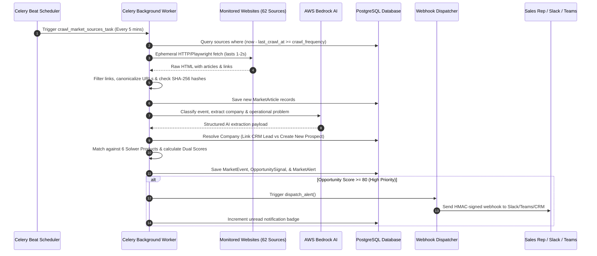

# Automotive Market Intelligence & Opportunity Detection System
## Complete System Architecture, Implementation & Deployment Blueprint

> **Status note:** this page is the original design blueprint. For implemented behavior, endpoints, scoring, operations and limitations, see [market-intelligence.md](market-intelligence.md). All code paths below are repository-relative.

---

### Table of Contents
1. [Executive Summary & Purpose](#1-executive-summary--purpose)
2. [Mandatory Technology Restrictions Compliance](#2-mandatory-technology-restrictions-compliance)
3. [Full Inventory of Completed Deliverables](#3-full-inventory-of-completed-deliverables)
4. [End-to-End Operational Workflow](#4-end-to-end-operational-workflow)
5. [Solwer Product Portfolio & Opportunity Mapping](#5-solwer-product-portfolio--opportunity-mapping)
6. [Explainable Dual Scoring Architecture](#6-explainable-dual-scoring-architecture)
7. [Inbound & Outbound Notification Infrastructure](#7-inbound--outbound-notification-infrastructure)
8. [Database Schema & Data Models](#8-database-schema--data-models)
9. [UI & Sales Rep User Experience](#9-ui--sales-rep-user-experience)
10. [Strategic Implementation & Expansion Opportunities](#10-strategic-implementation--expansion-opportunities)

---

### 1. Executive Summary & Purpose

The **Automotive Market Intelligence, Company Discovery & Opportunity Notification System** is an autonomous intelligence pipeline embedded inside **GTMProspecting**. 

#### Core Problem Solved:
Historically, B2B enterprise sales reps spend hours manually scouring news sites, industry portals, and company press releases trying to identify which automotive OEMs, tier-1 suppliers, or fleet operators are expanding, facing operational bottlenecks, or upgrading infrastructure. 

#### System Mission:
- Continuously and autonomously monitor the automotive ecosystem.
- Extract concrete business announcements and **specific operational bottlenecks**.
- Match operational gaps directly against the **6 official Solwer products** ([solverindia.com](https://solverindia.com)).
- Resolve companies against existing CRM leads or discover completely new prospects.
- Automatically calculate explainable **Market Signal Relevance** and **Sales Readiness** scores.
- Push real-time alerts and **pre-written, personalized cold outreach pitches** directly to salespeople and connected communication channels (Slack, Teams, Webhooks, CRM).

---

### 2. Mandatory Technology Restrictions Compliance

The system strictly adheres to all zero-third-party search API mandates:

| Restricted Technology | Status | Implementation Alternative |
|---|---|---|
| **GDELT / GNews / NewsAPI** | **Strictly Prohibited** | Zero external news aggregation APIs imported |
| **Google Search / Bing Search APIs** | **Strictly Prohibited** | Direct targeted monitoring of verified industry portals |
| **Tavily / SerpAPI** | **Strictly Prohibited** | Zero third-party SERP or scraping APIs |
| **Primary Discovery Engine** | **Mandatory** | Existing Playwright crawler: [`playwright_provider.py`](../backend/app/market_intelligence/providers/playwright_provider.py) |
| **HTTP Retrieval** | **Mandatory** | SSRF-safe HTTP client with browser user-agent emulation |
| **AI Intelligence & Analysis** | **Mandatory** | Existing AWS Bedrock (Claude / Titan): [`event_classifier.py`](../backend/app/market_intelligence/ai/event_classifier.py) |
| **Data & Background Stack** | **Mandatory** | PostgreSQL, Redis 7, Celery Worker, Next.js 15 |

---

### 3. Full Inventory of Completed Deliverables

#### Backend Deliverables ([`backend/app/market_intelligence/`](../backend/app/market_intelligence/))
1. **Core Data Models ([`models.py`](../backend/app/market_intelligence/models.py))**:
   - `MarketSource`: Monitored sources, domain, section URLs, priorities, and crawl intervals.
   - `MarketSourceRun`: Audit trail of scheduled crawl runs, articles discovered, and errors.
   - `MarketArticle`: Extracted articles with canonical URL, author, date, and SHA-256 fingerprint.
   - `MarketArticleVersion`: Revision tracking for modified announcements.
   - `MarketCompany`: Discovered prospects, corporate domain, parent entity, and CRM lead link.
   - `MarketEvent`: Classified business developments with specific operational problems extracted.
   - `ProductCatalog`: Solwer product registry with target segments and potential buyer personas.
   - `ProductMatchRule`: Configurable weighted keyword and category match rules.
   - `OpportunitySignal`: Qualified opportunities with dual scores, rationale, and next actions.
   - `MarketAlert`: In-app and outbound notifications for high-priority sales triggers.
   - `CompanyWatchlist`: Domain-level monitoring for key accounts.
   - `MarketWebhookSubscription`: Outbound webhook endpoints with HMAC-SHA256 signing.

2. **Automated Migrations**:
   - [`90a32bdfdc2e_add_automotive_market_intelligence_.py`](../backend/migrations/versions/90a32bdfdc2e_add_automotive_market_intelligence_.py): Complete relational schema.
   - [`a23dfc0ad970_add_market_webhook_subscriptions.py`](../backend/migrations/versions/a23dfc0ad970_add_market_webhook_subscriptions.py): Real-time webhook subscription table.

3. **Autonomous Intelligence Services**:
   - [`source_registry.py`](../backend/app/market_intelligence/services/source_registry.py): Seed registry of 62 Indian automotive websites across 7 sectors.
   - [`crawl_service.py`](../backend/app/market_intelligence/services/crawl_service.py): Delta detection, URL normalization, link filtering, and body extraction.
   - [`playwright_provider.py`](../backend/app/market_intelligence/providers/playwright_provider.py): SSRF-safe request engine, streaming HTML parser, JSON-LD news extractor.
   - [`event_classifier.py`](../backend/app/market_intelligence/ai/event_classifier.py): Bedrock prompt engineering for event categorization, company extraction, and bottleneck diagnosis.
   - [`company_resolution.py`](../backend/app/market_intelligence/services/company_resolution.py): Fuzzy matching against CRM leads vs discovered company deduplication.
   - [`product_matching.py`](../backend/app/market_intelligence/services/product_matching.py): Maps signals against the 6 Solwer products and generates custom pitches.
   - [`scorer.py`](../backend/app/market_intelligence/services/scorer.py): Transparent dual scoring algorithms.
   - [`webhook_dispatcher.py`](../backend/app/market_intelligence/services/webhook_dispatcher.py): HMAC-SHA256 signed outbound HTTP POST notifications formatted for Slack/Teams.
   - [`pipeline_orchestrator.py`](../backend/app/market_intelligence/services/pipeline_orchestrator.py): Orchestrates the full lifecycle from article extraction to alert generation.

4. **REST API Endpoints ([`routes.py`](../backend/app/market_intelligence/routes.py))**:
   - `GET /api/market-intelligence/overview`: Executive KPI counts and product breakdowns.
   - `GET /api/market-intelligence/feed`: Real-time streaming market event feed with filters.
   - `GET /api/market-intelligence/opportunities`: Scored opportunities with pitch recommendations.
   - `GET /api/market-intelligence/companies/discovered`: New companies with 1-click CRM approval.
   - `POST /api/market-intelligence/sources/{id}/crawl`: Immediate manual source crawl trigger.
   - `POST /api/market-intelligence/webhook`: Inbound real-time webhook listener.
   - `GET/POST/DELETE /api/market-intelligence/webhooks`: Outbound webhook subscription manager.
   - `POST /api/market-intelligence/webhooks/test`: Test webhook payload dispatcher.

5. **Background Automation ([`tasks.py`](../backend/app/tasks.py#L32))**:
   - Celery Beat schedule `crawl-market-sources` running every 5 minutes (`300s`).
   - Incremental crawl of sources due based on `crawl_frequency_minutes`.
   - Automatic queue processing of unanalyzed articles through Bedrock.

#### Frontend Deliverables ([`frontend/app/market-intelligence/`](../frontend/app/market-intelligence/))
1. **Interactive Radar Dashboard ([`page.tsx`](../frontend/app/market-intelligence/page.tsx))**:
   - **Executive Metric Cards**: Signals Today, High-Priority Opportunities, New Companies, Monitored Sources.
   - **Solwer Product Opportunity Cards**: Displaying counts and breakdown across all 6 products.
   - **Tabbed Views**: Live Market Feed, Qualified Opportunities, Discovered Companies, Source Manager, Watchlists, Outbound Webhook Subscriptions.
2. **Fixed Layout & Navigation**:
   - Removed duplicate topbar wrappers in `/market-intelligence` and `/zoho`.
   - Dynamic unread alert counter badge next to "Market Intelligence" in [`app-shell.tsx`](../frontend/components/app-shell.tsx).
3. **Interactive Numbers Drilldown Modal**:
   - Clicking on any KPI number or Solwer product pill opens a detailed 3-part modal:
     - **The News Announcement**: Headline, Publisher, Publication Date, Location, Excerpt.
     - **Where Solwer Directly Helps**:
       - 🚨 Operational Problem Identified.
       - ✨ Why Solwer is the Solution.
       - 🎯 Recommended Sales Outreach Pitch (ready to copy or send).
       - 👔 Target Buyer Personas.
       - 📊 Dual Score Points Breakdown.
     - **1-Click Sales Actions**: "Approve for Outreach", "View in Qualified Opportunities", "Add to Watchlist".
4. **1-Click Webhook Simulator**:
   - Built-in simulation modal with 4 realistic Indian automotive presets (Tata Motors TWMS, Mahindra Loss Tracker, Delhivery VDI/Fleet, Ashok Leyland Decarbonization).
5. **Lead 360 Deep Integration ([`frontend/app/leads/[id]/page.tsx`](../frontend/app/leads/[id]/page.tsx))**:
   - Autonomous market intelligence tab displaying real-time events, scores, and recommended pitches attached to CRM leads.

---

### 4. End-to-End Operational Workflow



---

### 5. Solwer Product Portfolio & Opportunity Mapping

The system matches announcements to the 6 official Solwer products:

| Solwer Product | Trigger Operational Problems | Target Buyer Personas | Ready Outreach Angle |
|---|---|---|---|
| **TWMS** *(Transport & Warehouse Management)* | Warehouse dispatch bottlenecks, inter-depot delays, freight route inefficiencies, logistics hub expansion. | VP Logistics, Chief Supply Chain Officer (CSCO), Distribution Head | Multi-depot and line-haul dispatch automation to reduce transit turnaround. |
| **Loss Tracker / IM** *(Integrated Manufacturing)* | Plant downtime, scrap/loss reduction, assembly line Kaizen, OEE visibility gaps, new manufacturing line launch. | Plant Head, VP Manufacturing Operations, Head of Continuous Improvement / Kaizen | Smart factory loss-reduction and OEE tracking to cut scrap on new assembly lines. |
| **VDI** *(Vehicle Digital Inspection)* | Pre-delivery damage claims, yard inspection backlogs, manual vehicle condition audit disputes. | Head of Quality Assurance, Yard Operations Director, Used Car Certification Lead | AI smartphone camera damage scanning and standardized digital inspection checklists. |
| **Fleet Management** | Turnaround delays, lack of driver pre/post-trip safety checklists, unscheduled vehicle maintenance. | Fleet Director, Transport Manager, Operations Lead | Driver pre-trip checklist portal, vehicle readiness tracking, and preventive maintenance logs. |
| **Mobility Aftermarket SuperApp (MCE)** | Workshop booking friction, fragmented spare parts distribution, independent aftermarket network disorganization. | Head of Aftermarket Sales, Dealership Network Director | Unified digital ecosystem connecting workshops, spare parts distributors, and fleets. |
| **Carbon Footprint Management** | BRSR Scope 1, 2, and 3 fleet emissions tracking mandates, sustainability compliance, OEM ESG requirements. | Head of ESG, Chief Sustainability Officer (CSO), Compliance Director | Enterprise carbon accounting and Scope 1-3 logistics emissions baseline for BRSR compliance. |

---

### 6. Explainable Dual Scoring Architecture

Every qualified opportunity generates two explainable, points-based scores ($0 - 100$):

```
Market Signal Relevance Score =
    Product Match Relevance (max 30 pts)
  + Event Type Strength     (max 25 pts)
  + Target ICP Fit          (max 20 pts)
  + Signal Recency          (max 15 pts)
  + CRM Relationship        (max 10 pts)
```

```
Sales Readiness Score =
    Verified Corporate Domain (30 pts)
  + Clear Operational Problem (30 pts)
  + Supporting Evidence/Links (25 pts)
  + CRM Account Status        (15 pts)
```

#### Priority Classification:
- 🔴 **High Priority ($\ge 80$)**: Immediate sales alert created, outbound webhooks dispatched, highlighted at the top of the dashboard.
- 🟡 **Medium Priority ($60 - 79$)**: Qualified opportunity displayed in the active radar feed.
- ⚪ **Low Priority ($< 60$)**: Stored for macro industry trend tracking.

---

### 7. Inbound & Outbound Notification Infrastructure

```
                      [External World]
                             │
            ┌────────────────┴────────────────┐
            ▼                                 ▼
[Inbound Webhook Listener]       [Outbound Webhook Dispatcher]
POST /api/market-intelligence/   POST to Slack / Teams / CRM
          webhook                with HMAC-SHA256 (X-GTM-Signature)
            │                                 ▲
            ▼                                 │
[Instant Bedrock Analysis] ──────────► [Score >= 80 Alert]
```

- **Inbound Endpoint (`POST /api/market-intelligence/webhook`)**: Ingests real-time feeds, tender alerts, or third-party webhooks without waiting for scheduled crawl cycles.
- **Outbound Dispatcher ([`webhook_dispatcher.py`](../backend/app/market_intelligence/services/webhook_dispatcher.py))**: Dispatches HTTP POST requests with:
  - `X-GTM-Signature`: HMAC SHA-256 hash of payload and secret.
  - `X-Webhook-Secret`: Verification secret token.
  - Native Slack and Microsoft Teams formatted payload cards.

---

### 8. Database Schema & Data Models

```
┌─────────────────┐       ┌─────────────────┐       ┌─────────────────┐
│  MarketSource   │──1:N──│ MarketSourceRun │       │ ProductCatalog  │
│(62 Targets/URLs)│       │  (Audit Log)    │       │   (6 Products)  │
└────────┬────────┘       └─────────────────┘       └────────┬────────┘
         │                                                   │
        1:N                                                 1:N
         │                                                   │
┌────────┴────────┐       ┌─────────────────┐       ┌────────┴────────┐
│  MarketArticle  │──1:1──│   MarketEvent   │──1:N──│ProductMatchRule │
│ (URL + SHA-256) │       │(Extracted Event)│       │ (Dynamic Rules) │
└─────────────────┘       └────────┬────────┘       └─────────────────┘
                                   │
                                  1:N
                                   │
┌─────────────────┐       ┌────────┴────────┐       ┌─────────────────┐
│  MarketCompany  │──1:N──│OpportunitySignal│──1:N──│   MarketAlert   │
│ (CRM/New Lead)  │       │ (Dual-Scored)   │       │(In-App/Webhook) │
└─────────────────┘       └─────────────────┘       └─────────────────┘
```

---

### 9. UI & Sales Rep User Experience

1. **Persistent Top Navigation**:
   - Single clean topbar with a real-time unread alert badge: `Market Intelligence [ 18 ]`.
2. **Interactive Overview**:
   - 4 Top Metric Cards (Signals Today, High-Priority Opportunities, New Companies, Active Sources).
   - 6 Solwer Product Cards displaying opportunity badges.
3. **Drilldown Modal**:
   - Clicking any number or product card immediately opens the drilldown modal showing the announcement, the specific operational problem, and the tailored pitch.
4. **CRM Lead 360**:
   - Opening any lead profile (`/leads/{id}`) surfaces real-time news intelligence and tailored pitches directly within the lead view.

---

### 10. Strategic Implementation & Expansion Opportunities

Here is how and where this system can be deployed and integrated across your organization:

#### A. Direct CRM Integration (Zoho CRM / Salesforce / HubSpot)
- **Automatic Lead Creation**: Discovered companies flagged as `pending_review` can be synced directly into Zoho CRM as Leads or Accounts upon 1-click sales approval.
- **Opportunity Notes**: Attach the extracted operational problem and pitch directly as a Note or Task under the Zoho Account.

#### B. Live Sales Channels (Slack & Microsoft Teams)
- Configure an outbound webhook pointing to a dedicated `#sales-leads-india` Slack channel or Teams webhook.
- Whenever a high-priority announcement (e.g. Tata Motors expanding a logistics depot) is detected, the bot posts the news headline, operational problem, and pre-written pitch instantly.

#### C. Automated Cold Outreach Cadences
- Connect qualified opportunities directly into the existing GTMProspecting outreach engine ([`app/tasks.py`](../backend/app/tasks.py#L25)).
- The generated pitch can automatically populate step 1 of an email cadence sent to verified contacts discovered via Apollo.

#### D. International Geographic Expansion
- The system is architected with `country` and `category` fields across sources and events.
- To expand beyond India to Southeast Asia, Europe, or North America, simply add the relevant regional OEM/supplier domains to `MarketSource`—the crawling, Bedrock analysis, and scoring engine will work without modifying code.

#### E. Adding New Products or Subsidiaries
- New software modules or hardware offerings can be added dynamically to `ProductCatalog` and `ProductMatchRule` without restarting the server or deploying new code.
